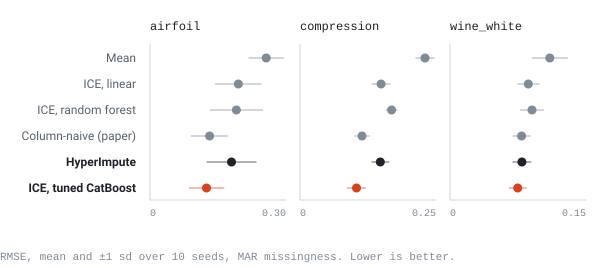

<picture>
  <source media="(prefers-color-scheme: dark)" srcset="assets/header_dark.svg">
  
</picture>

 

<a href="https://github.com/YannKleees?tab=repositories">
  <picture>
    <source media="(prefers-color-scheme: dark)" srcset="assets/repo_map_dark.svg">
    
  </picture>
</a>

### Featured

<b>hyperreimpute</b>: reproduction of HyperImpute (ICML 2022). A tuned single CatBoost had 6 to 31% lower RMSE than HyperImpute on all 3 datasets.

 

<picture>
  <source media="(prefers-color-scheme: dark)" srcset="assets/hyperreimpute_dark.svg">
  
</picture>

I reproduced Table 2 of the HyperImpute paper on three UCI datasets with 10 seeds each, reran the key methods under the older hyperimpute 0.1.5, and tested the method's limits under MCAR, MAR and MNAR missingness and on tables with few features. The paper's gain over the best single learner did not reproduce: the CatBoost learner in hyperimpute 0.1.17 defaults to 10 trees, and with sensible settings a single CatBoost beats the full method.

Stack: Python, hyperimpute and its CatBoost learners, pandas, NumPy, SciPy, seaborn.

[Repository](https://github.com/YannKleees/hyperreimpute)

### Toolbox

<!-- toolbox:start -->

Data and visualisation: pandas, NumPy, SciPy, Matplotlib, seaborn, NetworkX.
<!-- toolbox:end -->

### Contact

[LinkedIn](https://www.linkedin.com/in/yann-klees-a0b8a6334) · [yannklees@gmail.com](mailto:yannklees@gmail.com)
