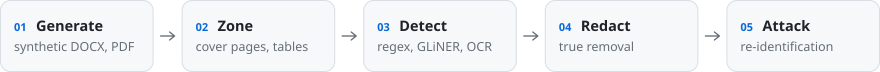
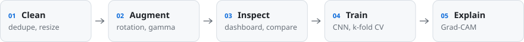
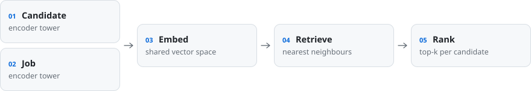
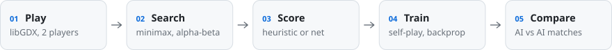
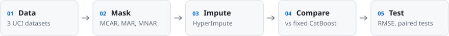
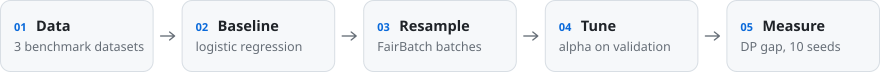
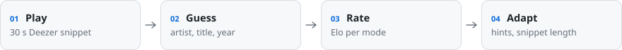
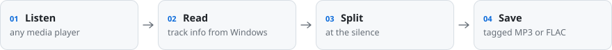

<picture><source media="(prefers-color-scheme: dark)" srcset="assets/profile_dark.svg"></picture>

<a href="https://www.linkedin.com/in/yann-klees-a0b8a6334"><picture><source media="(prefers-color-scheme: dark)" srcset="assets/buttons/linkedin_dark.svg"></picture></a>
<a href="mailto:yannklees@gmail.com"><picture><source media="(prefers-color-scheme: dark)" srcset="assets/buttons/email_dark.svg"></picture></a>

### Machine learning

<code>tagging/</code> &nbsp;personal data redaction in four languages

 

<picture><source media="(prefers-color-scheme: dark)" srcset="assets/flow/tagging_dark.svg"></picture>

Detects and redacts personal data in Luxembourgish, French, German and English text by combining a Rust rule engine with a GLiNER model. Recall on hard Luxembourgish names: 0.57 with rules alone, 0.91 combined. The rules also run in the browser.

<a href="https://github.com/YannKleees/tagging"><picture><source media="(prefers-color-scheme: dark)" srcset="assets/buttons/repo_dark.svg"></picture></a>
<a href="https://yannkleees.github.io/tagging/"><picture><source media="(prefers-color-scheme: dark)" srcset="assets/buttons/demo_dark.svg"></picture></a>

 

<code>pii-anonymisation-thesis/</code> &nbsp;BSc thesis on document anonymisation

 

<picture><source media="(prefers-color-scheme: dark)" srcset="assets/flow/pii-anonymisation-thesis_dark.svg"></picture>

Layout-aware anonymisation of student documents, tested with a re-identification attack. Recall 0.998 on 500 synthetic documents; the signals an attacker can use drop from 17.3 to 0.16 per document.

<a href="https://github.com/YannKleees/pii-anonymisation-thesis"><picture><source media="(prefers-color-scheme: dark)" srcset="assets/buttons/repo_dark.svg"></picture></a>

 

<code>orthodontic-par/</code> &nbsp;PAR index suggestions from dental photos

 

<picture><source media="(prefers-color-scheme: dark)" srcset="assets/flow/orthodontic-par_dark.svg"></picture>

Web app that suggests PAR index scores from intraoral photos for a clinician to review. The YOLO11s detector reaches mAP50 0.697 on the OMNI test set, above the dataset paper's best result (0.664).

<a href="https://github.com/YannKleees/orthodontic-par"><picture><source media="(prefers-color-scheme: dark)" srcset="assets/buttons/repo_dark.svg"></picture></a>

 

<code>team09/</code> &nbsp;brain tumour classification from MRI

 

<picture><source media="(prefers-color-scheme: dark)" srcset="assets/flow/team09_dark.svg"></picture>

Desktop app and research notebooks for a four-class brain tumour classifier (glioma, meningioma, pituitary, no tumour): duplicate removal, augmentation, a data dashboard, PyTorch CNN training with k-fold cross-validation and Grad-CAM inference in a PyQt5 interface, plus experiments on the BraTS 2023 data. Group project; I wrote most of the code.

<a href="https://github.com/YannKleees/team09"><picture><source media="(prefers-color-scheme: dark)" srcset="assets/buttons/repo_dark.svg"></picture></a>

 

<code>job-recommender/</code> &nbsp;two-tower job recommendations

 

<picture><source media="(prefers-color-scheme: dark)" srcset="assets/flow/job-recommender_dark.svg"></picture>

Matches candidates with job vacancies through a two-tower model, plus item-to-item retrieval for similar jobs. Group project; I built most of the engine. Private repository, code on request.

 

<code>recsys/</code> &nbsp;hotel recommendations on HotelRec

 

<picture><source media="(prefers-color-scheme: dark)" srcset="assets/flow/recsys_dark.svg"></picture>

Group project on HotelRec, a large set of TripAdvisor hotel reviews. My teammates built matrix factorisation and a hybrid with sub-ratings; I built the content-based recommender, which describes each hotel by the TF-IDF of its reviews (stemming, bigrams) and falls back to popular hotels for new users.

<a href="https://github.com/YannKleees/recsys"><picture><source media="(prefers-color-scheme: dark)" srcset="assets/buttons/repo_dark.svg"></picture></a>

 

<code>tak/</code> &nbsp;board game AI with a hand-written neural network

 

<picture><source media="(prefers-color-scheme: dark)" srcset="assets/flow/tak_dark.svg"></picture>

The board game Tak in Java with libGDX, playable against two AIs. One is minimax with alpha-beta pruning and a transposition table. The other uses the same search but scores positions with a neural network written from scratch, forward and backpropagation included, trained by self-play and against the heuristic agent. Group project; I wrote most of the code, including both AIs.

<a href="https://github.com/YannKleees/tak"><picture><source media="(prefers-color-scheme: dark)" srcset="assets/buttons/repo_dark.svg"></picture></a>

 

<code>hyperreimpute/</code> &nbsp;reproduction of an ICML 2022 paper

 

<picture><source media="(prefers-color-scheme: dark)" srcset="assets/flow/hyperreimpute_dark.svg"></picture>

Reproduction of HyperImpute on three UCI datasets, with a check against an older library version and tests of the method's limits. A CatBoost baseline with fixed settings beat it.

<a href="https://github.com/YannKleees/hyperreimpute"><picture><source media="(prefers-color-scheme: dark)" srcset="assets/buttons/repo_dark.svg"></picture></a>

 

<code>fairbatch/</code> &nbsp;fair training with FairBatch (ICLR 2021)

 

<picture><source media="(prefers-color-scheme: dark)" srcset="assets/flow/fairbatch_dark.svg"></picture>

Evaluation of FairBatch, a batch sampler that trains models towards demographic parity, on Adult, German and COMPAS over 10 seeds. It cut the parity gap on Adult from -0.19 to -0.03 and on COMPAS from -0.28 to 0.03, for 1.5 to 2.5 points of balanced accuracy. I also added a variant that updates the sampler from the measured gap.

<a href="https://github.com/YannKleees/fairbatch"><picture><source media="(prefers-color-scheme: dark)" srcset="assets/buttons/repo_dark.svg"></picture></a>

 

<code>r-projects/</code> &nbsp;machine learning in R

 

<picture><source media="(prefers-color-scheme: dark)" srcset="assets/flow/r-projects_dark.svg"></picture>

Two Quarto reports from the Utrecht machine learning course: predicting exam scores with cross-validated models and a tuned random forest, and clustering 5,000 IMDB reviews with K-means, a Gaussian mixture model and LDA. Group work, with each person's part listed.

<a href="https://github.com/YannKleees/r-projects"><picture><source media="(prefers-color-scheme: dark)" srcset="assets/buttons/repo_dark.svg"></picture></a>

 

### Software

<code>shortlist/</code> &nbsp;local job application tracker

 

<picture><source media="(prefers-color-scheme: dark)" srcset="assets/flow/shortlist_dark.svg"></picture>

Keeps the jobs I apply to in one SQLite file: paste a link and it extracts the posting, scores the fit against my CV, tracks replies and follow-ups, and drafts motivation letters with a local model through Ollama. FastAPI, runs on your own machine.

<a href="https://github.com/YannKleees/shortlist"><picture><source media="(prefers-color-scheme: dark)" srcset="assets/buttons/repo_dark.svg"></picture></a>

 

<code>music-mystery/</code> &nbsp;adaptive music guessing game

 

<picture><source media="(prefers-color-scheme: dark)" srcset="assets/flow/music-mystery_dark.svg"></picture>

Music guessing game built for an HCI user study, in a random and a personalised version. The personalised one keeps an Elo rating per mode and adapts hints and snippet length to the player.

<a href="https://github.com/YannKleees/music-mystery"><picture><source media="(prefers-color-scheme: dark)" srcset="assets/buttons/repo_dark.svg"></picture></a>

 

<code>pizza-ordering-system/</code> &nbsp;pizza shop on MySQL

 

<picture><source media="(prefers-color-scheme: dark)" srcset="assets/flow/pizza-ordering-system_dark.svg"></picture>

Desktop pizza shop with separate customer and staff apps on a 16-table MySQL schema, covering orders, loyalty rewards, deliveries and earnings reports.

<a href="https://github.com/YannKleees/pizza-ordering-system"><picture><source media="(prefers-color-scheme: dark)" srcset="assets/buttons/repo_dark.svg"></picture></a>

 

<code>record/</code> &nbsp;records what your PC plays

 

<picture><source media="(prefers-color-scheme: dark)" srcset="assets/flow/record_dark.svg"></picture>

Windows app that records whatever your PC plays and saves each track as a tagged MP3 or FLAC file, cut at the silence between tracks.

<a href="https://github.com/YannKleees/record"><picture><source media="(prefers-color-scheme: dark)" srcset="assets/buttons/repo_dark.svg"></picture></a>

 

<code>wichtel/</code> &nbsp;Secret Santa draw

 

<picture><source media="(prefers-color-scheme: dark)" srcset="assets/flow/wichtel_dark.svg"></picture>

Secret Santa draw as a static site. Everyone gets a private link that shows only their own match.

<a href="https://github.com/YannKleees/wichtel"><picture><source media="(prefers-color-scheme: dark)" srcset="assets/buttons/repo_dark.svg"></picture></a>

 

<code>datapluck/</code> &nbsp;copy tables and charts as data

 

<picture><source media="(prefers-color-scheme: dark)" srcset="assets/flow/datapluck_dark.svg"></picture>

Browser extension that copies any table or chart on a web page as CSV, LaTeX, pandas or R code. Private, in progress.

 

