<picture><source media="(prefers-color-scheme: dark)" srcset="assets/profile_dark.svg"></picture>

<a href="https://www.linkedin.com/in/yann-klees-a0b8a6334"><picture><source media="(prefers-color-scheme: dark)" srcset="assets/buttons/linkedin_dark.svg"></picture></a>
<a href="mailto:yannklees@gmail.com"><picture><source media="(prefers-color-scheme: dark)" srcset="assets/buttons/email_dark.svg"></picture></a>

Projects grouped by what I learned from them. Open a folder to see what it is built with, how it works and where the code is.

### Computer vision

Training image models and getting them into something a person can use: object detection with YOLO and Faster R-CNN, CNN classification with cross-validation, Grad-CAM to see what the model looks at.

<code>Nov 2026</code> &nbsp;<b>orthodontic-par/</b> &nbsp;PAR index suggestions from dental photos

 

<b>When</b> Nov 2026 &nbsp;·&nbsp; <b>Context</b> Rebuild of my 2025 internship work on public data

<picture><source media="(prefers-color-scheme: dark)" srcset="assets/stack/orthodontic-par_dark.svg"></picture>

<picture><source media="(prefers-color-scheme: dark)" srcset="assets/flow/orthodontic-par_dark.svg">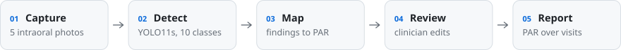</picture>

Web app that suggests PAR index scores from intraoral photos for a clinician to review. The YOLO11s detector reaches mAP50 0.697 on the OMNI test set, above the dataset paper's best result (0.664).

<a href="https://github.com/YannKleees/orthodontic-par"><picture><source media="(prefers-color-scheme: dark)" srcset="assets/buttons/repo_dark.svg"></picture></a>

 

<code>Summer 2025</code> &nbsp;<b>yolo-rcnn-pipeline/</b> &nbsp;detector training for dental images

 

<b>When</b> Summer 2025 &nbsp;·&nbsp; <b>Context</b> Research internship

<picture><source media="(prefers-color-scheme: dark)" srcset="assets/stack/yolo-rcnn-pipeline_dark.svg"></picture>

<picture><source media="(prefers-color-scheme: dark)" srcset="assets/flow/yolo-rcnn-pipeline_dark.svg">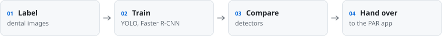</picture>

Training pipeline from my orthodontics internship: YOLO and Faster R-CNN detectors for dental images. It was the starting point for orthodontic-par, which replaces it.

<a href="https://github.com/YannKleees/yolo-rcnn-pipeline"><picture><source media="(prefers-color-scheme: dark)" srcset="assets/buttons/repo_dark.svg"></picture></a>

 

<code>Mar – Jun 2025</code> &nbsp;<b>team09/</b> &nbsp;brain tumour classification from MRI

 

<b>When</b> Mar – Jun 2025 &nbsp;·&nbsp; <b>Context</b> BSc group project, Maastricht

<picture><source media="(prefers-color-scheme: dark)" srcset="assets/stack/team09_dark.svg"></picture>

<picture><source media="(prefers-color-scheme: dark)" srcset="assets/flow/team09_dark.svg">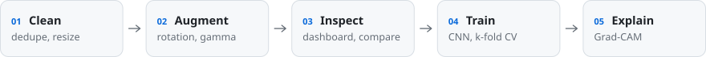</picture>

Desktop app and research notebooks for a four-class brain tumour classifier (glioma, meningioma, pituitary, no tumour): duplicate removal, augmentation, a data dashboard, PyTorch CNN training with k-fold cross-validation and Grad-CAM inference in a PyQt5 interface, plus experiments on the BraTS 2023 data. Group project; I wrote most of the code.

<a href="https://github.com/YannKleees/team09"><picture><source media="(prefers-color-scheme: dark)" srcset="assets/buttons/repo_dark.svg"></picture></a>

 

### Text and privacy

Finding personal data in text and documents: rules next to a named entity model, four languages, and checking the result with a re-identification attack.

<code>Oct – Nov 2026</code> &nbsp;<b>tagging/</b> &nbsp;personal data redaction in four languages

 

<b>When</b> Oct – Nov 2026 &nbsp;·&nbsp; <b>Context</b> Personal project

<picture><source media="(prefers-color-scheme: dark)" srcset="assets/stack/tagging_dark.svg"></picture>

<picture><source media="(prefers-color-scheme: dark)" srcset="assets/flow/tagging_dark.svg">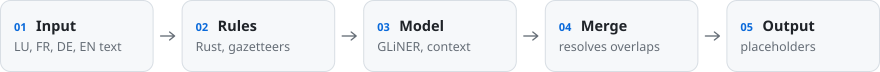</picture>

Detects and redacts personal data in Luxembourgish, French, German and English text by combining a Rust rule engine with a GLiNER model. Recall on hard Luxembourgish names: 0.57 with rules alone, 0.91 combined. The rules also run in the browser.

<a href="https://github.com/YannKleees/tagging"><picture><source media="(prefers-color-scheme: dark)" srcset="assets/buttons/repo_dark.svg"></picture></a>
<a href="https://yannkleees.github.io/tagging/"><picture><source media="(prefers-color-scheme: dark)" srcset="assets/buttons/demo_dark.svg"></picture></a>

 

<code>Feb – Jun 2026</code> &nbsp;<b>pii-anonymisation-thesis/</b> &nbsp;BSc thesis on document anonymisation

 

<b>When</b> Feb – Jun 2026 &nbsp;·&nbsp; <b>Context</b> BSc thesis, Maastricht

<picture><source media="(prefers-color-scheme: dark)" srcset="assets/stack/pii-anonymisation-thesis_dark.svg"></picture>

<picture><source media="(prefers-color-scheme: dark)" srcset="assets/flow/pii-anonymisation-thesis_dark.svg">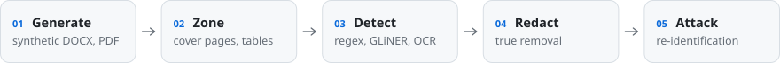</picture>

Layout-aware anonymisation of student documents, tested with a re-identification attack. Recall 0.998 on 500 synthetic documents; the signals an attacker can use drop from 17.3 to 0.16 per document.

<a href="https://github.com/YannKleees/pii-anonymisation-thesis"><picture><source media="(prefers-color-scheme: dark)" srcset="assets/buttons/repo_dark.svg"></picture></a>

 

### Recommender systems

Ranking items for a user: content-based with TF-IDF, matrix factorisation, two-tower retrieval, measured with HitRate and NDCG.

<code>Sep 2025 – Jan 2026</code> &nbsp;<b>job-recommender/</b> &nbsp;two-tower job recommendations

 

<b>When</b> Sep 2025 – Jan 2026 &nbsp;·&nbsp; <b>Context</b> BSc group project, Maastricht

<picture><source media="(prefers-color-scheme: dark)" srcset="assets/stack/job-recommender_dark.svg"></picture>

<picture><source media="(prefers-color-scheme: dark)" srcset="assets/flow/job-recommender_dark.svg">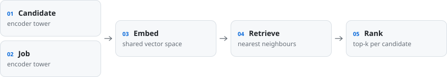</picture>

Matches candidates with job vacancies through a two-tower model, plus item-to-item retrieval for similar jobs. Group project; I built most of the engine. Private repository, code on request.

 

<code>Nov – Dec 2025</code> &nbsp;<b>recsys/</b> &nbsp;hotel recommendations on HotelRec

 

<b>When</b> Nov – Dec 2025 &nbsp;·&nbsp; <b>Context</b> BSc group project, Maastricht

<picture><source media="(prefers-color-scheme: dark)" srcset="assets/stack/recsys_dark.svg"></picture>

<picture><source media="(prefers-color-scheme: dark)" srcset="assets/flow/recsys_dark.svg"></picture>

Group project on HotelRec, a large set of TripAdvisor hotel reviews. My teammates built matrix factorisation and a hybrid with sub-ratings; I built the content-based recommender, which describes each hotel by the TF-IDF of its reviews (stemming, bigrams) and falls back to popular hotels for new users.

<a href="https://github.com/YannKleees/recsys"><picture><source media="(prefers-color-scheme: dark)" srcset="assets/buttons/repo_dark.svg"></picture></a>

 

### Machine learning methods and statistics

How methods behave when you test them yourself: reproducing papers, fairness, paired tests over seeds, a neural network and game search without a library, simulation.

<code>Nov 2026</code> &nbsp;<b>fairbatch/</b> &nbsp;fair training with FairBatch (ICLR 2021)

 

<b>When</b> Nov 2026 &nbsp;·&nbsp; <b>Context</b> MSc course work, Utrecht

<picture><source media="(prefers-color-scheme: dark)" srcset="assets/stack/fairbatch_dark.svg"></picture>

<picture><source media="(prefers-color-scheme: dark)" srcset="assets/flow/fairbatch_dark.svg">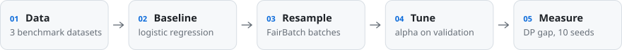</picture>

Evaluation of FairBatch, a batch sampler that trains models towards demographic parity, on Adult, German and COMPAS over 10 seeds. It cut the parity gap on Adult from -0.19 to -0.03 and on COMPAS from -0.28 to 0.03, for 1.5 to 2.5 points of balanced accuracy. I also added a variant that updates the sampler from the measured gap.

<a href="https://github.com/YannKleees/fairbatch"><picture><source media="(prefers-color-scheme: dark)" srcset="assets/buttons/repo_dark.svg"></picture></a>

 

<code>Oct – Nov 2026</code> &nbsp;<b>hyperreimpute/</b> &nbsp;reproduction of an ICML 2022 paper

 

<b>When</b> Oct – Nov 2026 &nbsp;·&nbsp; <b>Context</b> MSc course work, Utrecht

<picture><source media="(prefers-color-scheme: dark)" srcset="assets/stack/hyperreimpute_dark.svg"></picture>

<picture><source media="(prefers-color-scheme: dark)" srcset="assets/flow/hyperreimpute_dark.svg">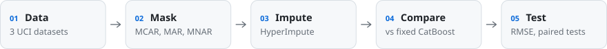</picture>

Reproduction of HyperImpute on three UCI datasets, with a check against an older library version and tests of the method's limits. A CatBoost baseline with fixed settings beat it.

<a href="https://github.com/YannKleees/hyperreimpute"><picture><source media="(prefers-color-scheme: dark)" srcset="assets/buttons/repo_dark.svg"></picture></a>

 

<code>Sep – Nov 2026</code> &nbsp;<b>r-projects/</b> &nbsp;machine learning in R

 

<b>When</b> Sep – Nov 2026 &nbsp;·&nbsp; <b>Context</b> MSc course work, Utrecht (group)

<picture><source media="(prefers-color-scheme: dark)" srcset="assets/stack/r-projects_dark.svg"></picture>

<picture><source media="(prefers-color-scheme: dark)" srcset="assets/flow/r-projects_dark.svg">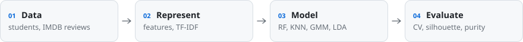</picture>

Two Quarto reports from the Utrecht machine learning course: predicting exam scores with cross-validated models and a tuned random forest, and clustering 5,000 IMDB reviews with K-means, a Gaussian mixture model and LDA. Group work, with each person's part listed.

<a href="https://github.com/YannKleees/r-projects"><picture><source media="(prefers-color-scheme: dark)" srcset="assets/buttons/repo_dark.svg"></picture></a>
<a href="https://yannkleees.github.io/r-projects/"><picture><source media="(prefers-color-scheme: dark)" srcset="assets/buttons/demo_dark.svg"></picture></a>

 

<code>Nov 2025</code> &nbsp;<b>matlab-simulation/</b> &nbsp;random numbers, ECG cleaning and a queue simulation in MATLAB

 

<b>When</b> Nov 2025 &nbsp;·&nbsp; <b>Context</b> BSc individual assignment, Maastricht

<picture><source media="(prefers-color-scheme: dark)" srcset="assets/stack/matlab-simulation_dark.svg">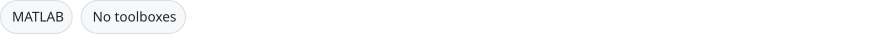</picture>

<picture><source media="(prefers-color-scheme: dark)" srcset="assets/flow/matlab-simulation_dark.svg">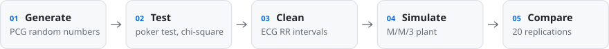</picture>

Individual assignment in plain MATLAB, without toolboxes: a permuted congruential random number generator checked with a poker test, outlier cleaning of ECG RR intervals with five views of before and after, and a discrete event simulation of a three-machine plant with maintenance.

<a href="https://github.com/YannKleees/matlab-simulation"><picture><source media="(prefers-color-scheme: dark)" srcset="assets/buttons/repo_dark.svg"></picture></a>

 

<code>Sep 2024 – Jan 2025</code> &nbsp;<b>tak/</b> &nbsp;board game AI with a hand-written neural network

 

<b>When</b> Sep 2024 – Jan 2025 &nbsp;·&nbsp; <b>Context</b> BSc group project, Maastricht

<picture><source media="(prefers-color-scheme: dark)" srcset="assets/stack/tak_dark.svg"></picture>

<picture><source media="(prefers-color-scheme: dark)" srcset="assets/flow/tak_dark.svg">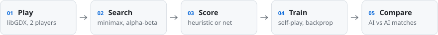</picture>

The board game Tak in Java with libGDX, playable against two AIs. One is minimax with alpha-beta pruning and a transposition table. The other uses the same search but scores positions with a neural network written from scratch, forward and backpropagation included, trained by self-play and against the heuristic agent. Group project; I wrote most of the code, including both AIs.

<a href="https://github.com/YannKleees/tak"><picture><source media="(prefers-color-scheme: dark)" srcset="assets/buttons/repo_dark.svg"></picture></a>

 

### Databases and web apps

Apps that sit on a database: schema design and SQL in MySQL, SQLite and Postgres, an API in between and an interface on top.

<code>Nov 2026</code> &nbsp;<b>shortlist/</b> &nbsp;Sift, a job search app that scores postings against my CV

 

<b>When</b> Nov 2026 &nbsp;·&nbsp; <b>Context</b> Personal project

<picture><source media="(prefers-color-scheme: dark)" srcset="assets/stack/shortlist_dark.svg"></picture>

<picture><source media="(prefers-color-scheme: dark)" srcset="assets/flow/shortlist_dark.svg"></picture>

Sift (the repository keeps its old name, shortlist) searches seven job sites, reads each posting and shows how well it fits my CV, with the reasons. It tracks applications, replies and interviews, and drafts motivation letters with Claude or a local Ollama model. Built for my own job search, with a lot of AI assistance.

<a href="https://github.com/YannKleees/shortlist"><picture><source media="(prefers-color-scheme: dark)" srcset="assets/buttons/repo_dark.svg"></picture></a>

 

<code>Oct 2024, web interface Nov 2026</code> &nbsp;<b>pizza-ordering-system/</b> &nbsp;pizza shop on MySQL, desktop and web

 

<b>When</b> Oct 2024, web interface Nov 2026 &nbsp;·&nbsp; <b>Context</b> BSc Databases course, Maastricht

<picture><source media="(prefers-color-scheme: dark)" srcset="assets/stack/pizza-ordering-system_dark.svg"></picture>

<picture><source media="(prefers-color-scheme: dark)" srcset="assets/flow/pizza-ordering-system_dark.svg">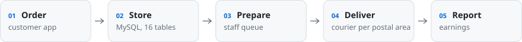</picture>

Pizza shop on a 16-table MySQL schema with a customer and a staff app: orders, discount codes, a loyalty count, deliveries by postal area and earnings reports. Built as desktop apps for the Databases course in 2024. In 2026 I added a web interface on the same database and ordering logic, with a live order queue next to a street map; that web layer was written with AI assistance.

<a href="https://github.com/YannKleees/pizza-ordering-system"><picture><source media="(prefers-color-scheme: dark)" srcset="assets/buttons/repo_dark.svg"></picture></a>

 

<code>Feb 2026</code> &nbsp;<b>fridgy/</b> &nbsp;scan a receipt, track the pantry, get recipes

 

<b>When</b> Feb 2026 &nbsp;·&nbsp; <b>Context</b> Weekend team project

<picture><source media="(prefers-color-scheme: dark)" srcset="assets/stack/fridgy_dark.svg">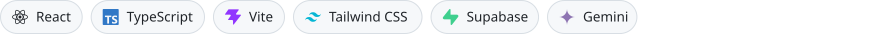</picture>

<picture><source media="(prefers-color-scheme: dark)" srcset="assets/flow/fridgy_dark.svg">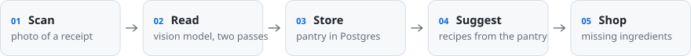</picture>

Mobile-first pantry app from a weekend team project. You photograph a grocery receipt, a vision model reads the items into your pantry, and a recipe chat suggests meals from what you already have. Missing ingredients go to a shopping list. Prototyped in Lovable; the repository is the cleaned-up code.

<a href="https://github.com/YannKleees/fridgy"><picture><source media="(prefers-color-scheme: dark)" srcset="assets/buttons/repo_dark.svg"></picture></a>

 

<code>Feb – Mar 2025</code> &nbsp;<b>music-mystery/</b> &nbsp;adaptive music guessing game

 

<b>When</b> Feb – Mar 2025 &nbsp;·&nbsp; <b>Context</b> BSc group project (HCI), Maastricht

<picture><source media="(prefers-color-scheme: dark)" srcset="assets/stack/music-mystery_dark.svg"></picture>

<picture><source media="(prefers-color-scheme: dark)" srcset="assets/flow/music-mystery_dark.svg">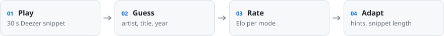</picture>

Music guessing game built for an HCI user study, in a random and a personalised version. The personalised one keeps an Elo rating per mode and adapts hints and snippet length to the player.

<a href="https://github.com/YannKleees/music-mystery"><picture><source media="(prefers-color-scheme: dark)" srcset="assets/buttons/repo_dark.svg"></picture></a>

 

### Small tools

Things I wanted to exist, built end to end and shipped.

<code>Nov 2026</code> &nbsp;<b>wichtel/</b> &nbsp;Secret Santa draw

 

<b>When</b> Nov 2026 &nbsp;·&nbsp; <b>Context</b> Personal project

<picture><source media="(prefers-color-scheme: dark)" srcset="assets/stack/wichtel_dark.svg">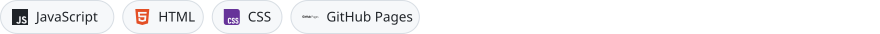</picture>

<picture><source media="(prefers-color-scheme: dark)" srcset="assets/flow/wichtel_dark.svg"></picture>

Secret Santa draw as a static site. Everyone gets a private link that shows only their own match.

<a href="https://github.com/YannKleees/wichtel"><picture><source media="(prefers-color-scheme: dark)" srcset="assets/buttons/repo_dark.svg"></picture></a>
<a href="https://yannkleees.github.io/wichtel/"><picture><source media="(prefers-color-scheme: dark)" srcset="assets/buttons/demo_dark.svg"></picture></a>

 

<code>Oct 2026</code> &nbsp;<b>record/</b> &nbsp;records what your PC plays

 

<b>When</b> Oct 2026 &nbsp;·&nbsp; <b>Context</b> Personal project

<picture><source media="(prefers-color-scheme: dark)" srcset="assets/stack/record_dark.svg"></picture>

<picture><source media="(prefers-color-scheme: dark)" srcset="assets/flow/record_dark.svg">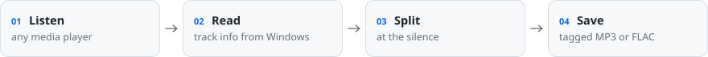</picture>

Windows app that records whatever your PC plays and saves each track as a tagged MP3 or FLAC file, cut at the silence between tracks.

<a href="https://github.com/YannKleees/record"><picture><source media="(prefers-color-scheme: dark)" srcset="assets/buttons/repo_dark.svg"></picture></a>

 

<code>Oct 2026</code> &nbsp;<b>datapluck/</b> &nbsp;copy tables and charts as data

 

<b>When</b> Oct 2026 &nbsp;·&nbsp; <b>Context</b> Personal project, in progress

<picture><source media="(prefers-color-scheme: dark)" srcset="assets/stack/datapluck_dark.svg"></picture>

<picture><source media="(prefers-color-scheme: dark)" srcset="assets/flow/datapluck_dark.svg"></picture>

Browser extension that copies any table or chart on a web page as CSV, LaTeX, pandas or R code. Private repository, in progress.

 

