

<picture><source media="(prefers-color-scheme: dark)" srcset="assets/header_bar_dark.svg"></picture>

<picture><source media="(prefers-color-scheme: dark)" srcset="assets/header_dark.svg"></picture>

<a href="https://www.linkedin.com/in/yann-klees-a0b8a6334"><picture><source media="(prefers-color-scheme: dark)" srcset="assets/links/linkedin_dark.svg"></picture></a>
<a href="mailto:yannklees@gmail.com"><picture><source media="(prefers-color-scheme: dark)" srcset="assets/links/email_dark.svg"></picture></a>

<picture><source media="(prefers-color-scheme: dark)" srcset="assets/stats_dark.svg"></picture>

<b><code>~/projects</code></b> &nbsp;click a folder to open it, then a project to see how it works

 
<blockquote>

<b><code>nlp-and-privacy/</code></b> &nbsp;2 projects

<blockquote>

<code>tagging/</code> &nbsp;finds and redacts personal data in Luxembourgish, French, German and English text

 

<a href="https://github.com/YannKleees/tagging"><picture><source media="(prefers-color-scheme: dark)" srcset="assets/diagrams/tagging_dark.svg">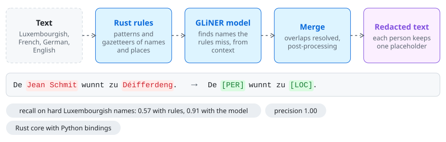</picture></a>

<pre>
<a href="https://github.com/YannKleees/tagging">tagging/</a>
├── <a href="https://github.com/YannKleees/tagging/tree/main/core">core/</a>     Rust engine: rules and gazetteers
├── <a href="https://github.com/YannKleees/tagging/tree/main/tagging">tagging/</a>  Python side: GLiNER model, merging, post-processing
├── <a href="https://github.com/YannKleees/tagging/tree/main/eval">eval/</a>     datasets, benchmark and evaluation
├── <a href="https://github.com/YannKleees/tagging/tree/main/tests">tests/</a>
└── <a href="https://github.com/YannKleees/tagging#readme">README.md</a>
</pre>

<a href="https://github.com/YannKleees/tagging"><picture><source media="(prefers-color-scheme: dark)" srcset="assets/links/tagging_dark.svg"></picture></a>

<code>pii-anonymisation-thesis/</code> &nbsp;BSc thesis: anonymising student documents and attacking the result

 

<a href="https://github.com/YannKleees/pii-anonymisation-thesis"><picture><source media="(prefers-color-scheme: dark)" srcset="assets/diagrams/pii-anonymisation-thesis_dark.svg">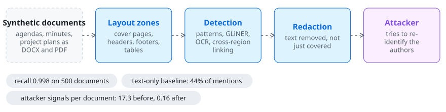</picture></a>

<pre>
<a href="https://github.com/YannKleees/pii-anonymisation-thesis">pii-anonymisation-thesis/</a>
├── <a href="https://github.com/YannKleees/pii-anonymisation-thesis/tree/master/thesis_project">thesis_project/</a>      defender, attacker, training and experiments
├── <a href="https://github.com/YannKleees/pii-anonymisation-thesis/tree/master/document_generator">document_generator/</a>  synthetic student documents
├── <a href="https://github.com/YannKleees/pii-anonymisation-thesis/tree/master/notebooks">notebooks/</a>           one notebook per research question
├── <a href="https://github.com/YannKleees/pii-anonymisation-thesis/tree/master/UI">UI/</a>                  Streamlit demo and labelling tool
└── <a href="https://github.com/YannKleees/pii-anonymisation-thesis#readme">README.md</a>
</pre>

<a href="https://github.com/YannKleees/pii-anonymisation-thesis"><picture><source media="(prefers-color-scheme: dark)" srcset="assets/links/pii-anonymisation-thesis_dark.svg"></picture></a>

</blockquote>

<b><code>computer-vision/</code></b> &nbsp;1 project

<blockquote>

<code>orthodontic-par/</code> &nbsp;dental photos to PAR index suggestions, with a clinician in the loop

 

<a href="https://github.com/YannKleees/orthodontic-par"><picture><source media="(prefers-color-scheme: dark)" srcset="assets/diagrams/orthodontic-par_dark.svg">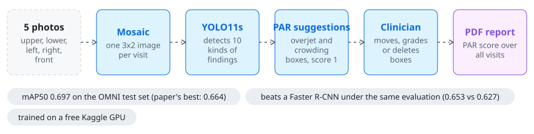</picture></a>

<pre>
<a href="https://github.com/YannKleees/orthodontic-par">orthodontic-par/</a>
├── <a href="https://github.com/YannKleees/orthodontic-par/tree/master/ml">ml/</a>        YOLO11 training, inference, Faster R-CNN comparison
├── <a href="https://github.com/YannKleees/orthodontic-par/tree/master/backend">backend/</a>   Express API, mosaic, PAR scoring, PDF reports
├── <a href="https://github.com/YannKleees/orthodontic-par/tree/master/frontend">frontend/</a>  React editor for the suggested boxes
├── <a href="https://github.com/YannKleees/orthodontic-par/tree/master/report">report/</a>    write-up of the follow-up on public data
└── <a href="https://github.com/YannKleees/orthodontic-par#readme">README.md</a>
</pre>

<a href="https://github.com/YannKleees/orthodontic-par"><picture><source media="(prefers-color-scheme: dark)" srcset="assets/links/orthodontic-par_dark.svg"></picture></a>

</blockquote>

<b><code>recommender-systems/</code></b> &nbsp;1 project

<blockquote>

<code>job-recommender/</code> &nbsp;matches candidates with jobs · private

 

<picture><source media="(prefers-color-scheme: dark)" srcset="assets/diagrams/job-recommender_dark.svg">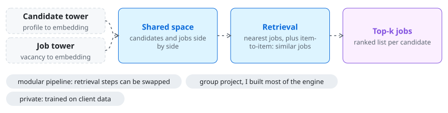</picture>

Private repository: code on request.

</blockquote>

<b><code>research-reproduction/</code></b> &nbsp;1 project

<blockquote>

<code>hyperreimpute/</code> &nbsp;reproduction of HyperImpute (ICML 2022) on three datasets

 

<a href="https://github.com/YannKleees/hyperreimpute"><picture><source media="(prefers-color-scheme: dark)" srcset="assets/diagrams/hyperreimpute_dark.svg">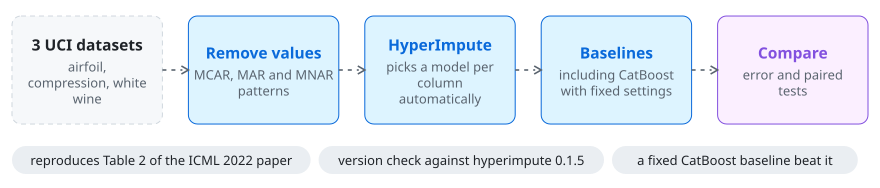</picture></a>

<pre>
<a href="https://github.com/YannKleees/hyperreimpute">hyperreimpute/</a>
├── <a href="https://github.com/YannKleees/hyperreimpute/blob/main/reproduction.ipynb">reproduction.ipynb</a>  every experiment, table and figure
├── <a href="https://github.com/YannKleees/hyperreimpute/tree/main/hyperreimpute">hyperreimpute/</a>      the code behind the notebook
├── <a href="https://github.com/YannKleees/hyperreimpute/tree/main/results">results/</a>            cached results, one CSV per experiment
├── <a href="https://github.com/YannKleees/hyperreimpute/tree/main/docs">docs/</a>               the report
└── <a href="https://github.com/YannKleees/hyperreimpute#readme">README.md</a>
</pre>

<a href="https://github.com/YannKleees/hyperreimpute"><picture><source media="(prefers-color-scheme: dark)" srcset="assets/links/hyperreimpute_dark.svg"></picture></a>

</blockquote>

<b><code>apps/</code></b> &nbsp;3 projects

<blockquote>

<code>music-mystery/</code> &nbsp;music guessing game that adapts to the player

 

<a href="https://github.com/YannKleees/music-mystery"><picture><source media="(prefers-color-scheme: dark)" srcset="assets/diagrams/music-mystery_dark.svg">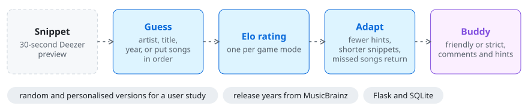</picture></a>

<pre>
<a href="https://github.com/YannKleees/music-mystery">music-mystery/</a>
├── <a href="https://github.com/YannKleees/music-mystery/tree/master/src">src/</a>    Flask app, game logic, Deezer and MusicBrainz
├── <a href="https://github.com/YannKleees/music-mystery/tree/master/tests">tests/</a>
└── <a href="https://github.com/YannKleees/music-mystery#readme">README.md</a>
</pre>

<a href="https://github.com/YannKleees/music-mystery"><picture><source media="(prefers-color-scheme: dark)" srcset="assets/links/music-mystery_dark.svg"></picture></a>

<code>pizza-ordering-system/</code> &nbsp;pizza shop on a MySQL database: customer and staff apps

 

<a href="https://github.com/YannKleees/pizza-ordering-system"><picture><source media="(prefers-color-scheme: dark)" srcset="assets/diagrams/pizza-ordering-system_dark.svg">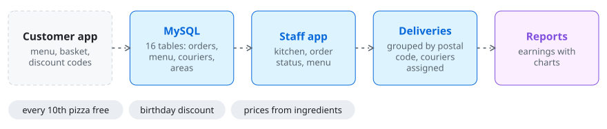</picture></a>

<pre>
<a href="https://github.com/YannKleees/pizza-ordering-system">pizza-ordering-system/</a>
├── <a href="https://github.com/YannKleees/pizza-ordering-system/tree/master/customer_app">customer_app/</a>  menu, basket, discounts, loyalty, orders
├── <a href="https://github.com/YannKleees/pizza-ordering-system/tree/master/staff_app">staff_app/</a>     kitchen, deliveries, menu management, earnings
├── <a href="https://github.com/YannKleees/pizza-ordering-system/tree/master/db">db/</a>            16-table schema and example data
└── <a href="https://github.com/YannKleees/pizza-ordering-system#readme">README.md</a>
</pre>

<a href="https://github.com/YannKleees/pizza-ordering-system"><picture><source media="(prefers-color-scheme: dark)" srcset="assets/links/pizza-ordering-system_dark.svg"></picture></a>

<code>wichtel/</code> &nbsp;Secret Santa draw for a group of friends

 

<a href="https://github.com/YannKleees/wichtel"><picture><source media="(prefers-color-scheme: dark)" srcset="assets/diagrams/wichtel_dark.svg">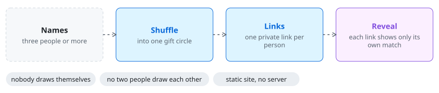</picture></a>

<pre>
<a href="https://github.com/YannKleees/wichtel">wichtel/</a>
├── <a href="https://github.com/YannKleees/wichtel/blob/main/index.html">index.html</a>
├── <a href="https://github.com/YannKleees/wichtel/blob/main/draw.js">draw.js</a>     the draw: one random gift circle
├── <a href="https://github.com/YannKleees/wichtel/blob/main/app.js">app.js</a>      links and reveal page
└── <a href="https://github.com/YannKleees/wichtel#readme">README.md</a>
</pre>

<a href="https://github.com/YannKleees/wichtel"><picture><source media="(prefers-color-scheme: dark)" srcset="assets/links/wichtel_dark.svg"></picture></a>

</blockquote>

<b><code>tools/</code></b> &nbsp;2 projects

<blockquote>

<code>record/</code> &nbsp;records what your PC plays into separate, tagged tracks

 

<a href="https://github.com/YannKleees/record"><picture><source media="(prefers-color-scheme: dark)" srcset="assets/diagrams/record_dark.svg">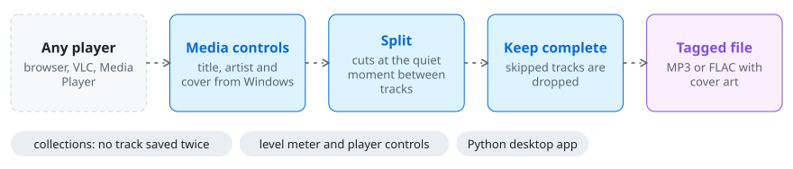</picture></a>

<pre>
<a href="https://github.com/YannKleees/record">record/</a>
├── <a href="https://github.com/YannKleees/record/tree/main/record">record/</a>    recording engine and desktop UI
├── <a href="https://github.com/YannKleees/record/tree/main/tests">tests/</a>
├── <a href="https://github.com/YannKleees/record/blob/main/start.bat">start.bat</a>
└── <a href="https://github.com/YannKleees/record#readme">README.md</a>
</pre>

<a href="https://github.com/YannKleees/record"><picture><source media="(prefers-color-scheme: dark)" srcset="assets/links/record_dark.svg"></picture></a>

<code>datapluck/</code> &nbsp;copy any table or chart on a web page as data · private, in progress

 

<picture><source media="(prefers-color-scheme: dark)" srcset="assets/diagrams/datapluck_dark.svg">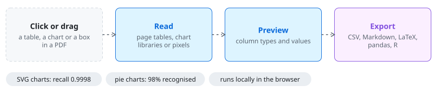</picture>

Private repository: code on request.

</blockquote>

</blockquote>

The header, diagrams and stats are drawn by the scripts in <a href="generator">generator/</a>; upload a new photo there and the header redraws itself.
