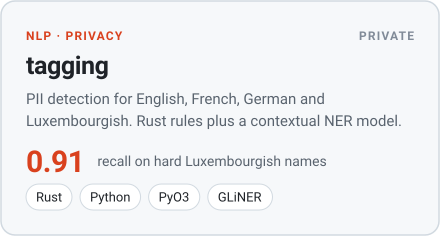
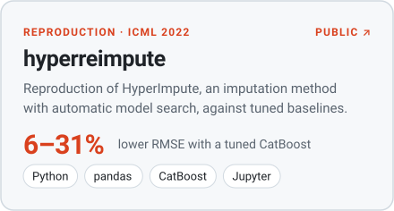
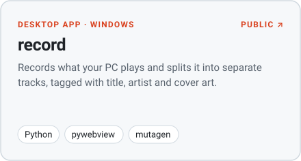
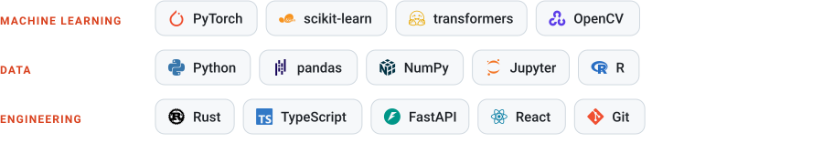

<picture>
  <source media="(prefers-color-scheme: dark)" srcset="assets/header_dark.svg">
  
</picture>

### Projects

<picture><source media="(prefers-color-scheme: dark)" srcset="assets/cards/thesis_dark.svg"></picture>

<picture><source media="(prefers-color-scheme: dark)" srcset="assets/cards/tagging_dark.svg"></picture>
<a href="https://github.com/YannKleees/hyperreimpute"><picture><source media="(prefers-color-scheme: dark)" srcset="assets/cards/hyperreimpute_dark.svg"></picture></a>

<picture><source media="(prefers-color-scheme: dark)" srcset="assets/cards/recommender_dark.svg"></picture>
<picture><source media="(prefers-color-scheme: dark)" srcset="assets/cards/dental_dark.svg"></picture>

<picture><source media="(prefers-color-scheme: dark)" srcset="assets/cards/datapluck_dark.svg"></picture>
<a href="https://github.com/YannKleees/record"><picture><source media="(prefers-color-scheme: dark)" srcset="assets/cards/record_dark.svg"></picture></a>

### Stack

<picture>
  <source media="(prefers-color-scheme: dark)" srcset="assets/stack_dark.svg">
  
</picture>

Private projects: code on request. [LinkedIn](https://www.linkedin.com/in/yann-klees-a0b8a6334) · [yannklees@gmail.com](mailto:yannklees@gmail.com)
